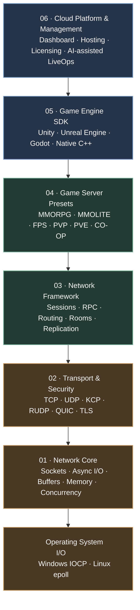

# LyntraNet

<div align="center">

### Latency-Native Transport Network

**A low-level, performance-oriented networking foundation for multiplayer games.**

[](https://en.cppreference.com/w/cpp/20)
[-0078D6)](#-platform-strategy)
[-064F8C?logo=cmake&logoColor=white)](#-development-status)
[](#-licensing)
[](#-development-status)

*Build the network. Build the game.*

</div>

---

## Contents

- [What is LyntraNet?](#-what-is-lyntranet)
- [Vision & design principles](#-vision--design-principles)
- [Architecture](#-architecture)
- [Transport & platform strategy](#-transport--platform-strategy)
- [Game server presets](#-game-server-presets)
- [Engine SDKs](#-game-engine-sdks)
- [Platform & operations](#-platform--operations)
- [Development status](#-development-status)
- [Roadmap](#-roadmap)
- [Validation: Blockia](#-validation-blockia)
- [Performance & quality](#-performance--quality)
- [Repository layout](#-repository-layout)
- [Build & development](#-build--development)
- [Licensing](#-licensing)
- [Contributing](#-contributing)
- [Related projects](#-related-projects)

---

## ✦ What is LyntraNet?

**LyntraNet** is a C++20 cross-platform game networking framework under active development. Its long-term objective is to bring together the control of a self-hosted networking stack and the convenience of a managed multiplayer platform.

The project is being developed from the bottom up: starting with platform-level I/O, sockets, buffers, and concurrency primitives, then growing into transport services, reusable game-networking components, engine integrations, and operational tooling.

Rather than forcing every project into one server architecture, LyntraNet is intended to expose composable layers. Developers should be able to work close to the network when they need precise control, or use higher-level building blocks when they want to focus on gameplay.

### At a glance

| Area | Direction |
| :--- | :--- |
| Language & standard | C++20 |
| Primary domain | Multiplayer game networking |
| Initial backend focus | Windows / IOCP |
| Cross-platform target | Windows and Linux; additional backends under consideration |
| Network models | Reliable and unreliable transport |
| Integration targets | Native C++, Unity, Unreal Engine, Godot |
| Long-term platform | Self-hosted infrastructure + managed cloud services |
| Current maturity | Early development; APIs and architecture may change |

> **Project maturity:** LyntraNet is not yet a production-ready networking product. The architecture below describes a combination of current implementation work and the intended long-term platform. Each item is labelled accordingly where possible.

---

## ◈ Vision & design principles

### Performance without hiding the machine

Networking performance is shaped by data movement, memory lifetime, cache locality, synchronization, and operating-system I/O. LyntraNet prioritizes these concerns in its low-level design.

- Asynchronous, platform-native I/O
- Explicit buffer and object lifetime management
- Cache-conscious data structures
- Reduced copying and synchronization overhead where practical
- Repeatable benchmarks instead of unsupported performance claims

### A layered API

The low-level core should remain useful on its own. Higher layers add convenience without making the underlying system inaccessible.

### Composition over monoliths

Server applications should be assembled from reusable roles and services. A gateway, match server, zone server, and world server should be composable rather than locked into one all-purpose server type.

### Platform-aware abstraction

A common interface should make applications portable while still allowing each operating system to use its native strengths.

### Server-authoritative by design

Clients are untrusted. Game-critical state, validation, and authoritative simulation belong on the server.

---

## 🧱 Architecture

LyntraNet's target architecture is organized into six layers. The first layers form the networking foundation; the later layers expand the project into a complete developer and operations platform.



### 01 — Network Core

The core is the low-level foundation. It owns operating-system interaction and the primitives required by the layers above it.

**Responsibilities**

- Socket and endpoint abstractions
- Listener and connection lifecycle
- Asynchronous I/O contexts and completion processing
- Platform backend boundary
- Send/receive buffer management
- Ring buffers and packet buffer handling
- Concurrency utilities and worker execution
- Memory allocation and object lifetime strategy
- Network event processing and error propagation

**Implementation direction**

The repository currently contains Windows-oriented socket, listener, connection, and transport code, an IOCP backend type, and concurrent ring-buffer implementations. Linux epoll and other platform backends are targets, not claims of completed support.

### 02 — Transport & Security

This layer separates delivery semantics from game-level messaging. Different games can select reliable, unreliable, or specialized transports according to their latency and delivery requirements.

| Technology | Intended role | Status |
| :--- | :--- | :--- |
| TCP | Reliable, ordered stream transport | Initial implementation focus |
| UDP | Low-overhead datagram transport | Planned |
| KCP | Reliable delivery over UDP | Planned |
| RUDP | Tunable reliable datagram transport | Planned / design |
| QUIC | Modern secure transport over UDP | Planned / evaluation |
| TLS / SSL | Transport encryption and authentication | Planned |
| RTP | Real-time audio/media transport | Under consideration |

**Security direction**

- Encrypted transport where appropriate
- Authentication and integrity protection for datagram-based traffic
- Session authentication and packet validation
- Replay-attack resistance
- Key exchange, rotation, and secure key management

Security mechanisms will be designed per transport rather than assuming that encryption alone provides authentication, integrity, or replay protection.

### 03 — Network Framework

The framework turns transport primitives into reusable multiplayer building blocks.

| Component | Responsibility |
| :--- | :--- |
| Session & connection management | Track peers and connection lifecycle |
| Serialization | Encode and decode application messages |
| RPC & message routing | Dispatch requests and events |
| Room & lobby services | Organize players into shared sessions |
| Matchmaking | Form matches from player or party criteria |
| State synchronization | Distribute authoritative state |
| Entity replication | Replicate relevant game entities |
| Chat & events | Provide common real-time messaging patterns |
| Server-to-server communication | Connect distributed server roles |

The API boundaries and final module set will be refined as the Core and transport layers stabilize.

### 04 — Game Server Presets

Presets provide starting architectures for common game-server workloads. They are intended to be configurable compositions of framework components, not rigid genre-specific engines.

Examples include:

- **MMORPG** — persistent worlds, zones, channels, and inter-server coordination
- **MMOLITE** — smaller persistent worlds with room- and instance-based services
- **PVP** — matchmaking, authoritative simulation, and state synchronization
- **PVE** — parties, instances, and cooperative AI/world-state replication
- **CO-OP** — session and room management for host-based or dedicated servers
- **FPS** — low-latency updates, fixed ticks, snapshots, and investigation of lag compensation

### 05 — Game Engine SDK

The networking core is intended to remain engine-agnostic. Engine-specific SDKs will expose idiomatic APIs while sharing the same underlying services.

| Engine | Planned integration |
| :--- | :--- |
| Unity | C# SDK, native plugin, async APIs, event/callback integration |
| Unreal Engine | C++ plugin/module; Blueprint integration under evaluation |
| Godot | GDExtension integration; GDScript-facing API under evaluation |
| Native C++ | Direct access to the C++ framework |

### 06 — Cloud Platform & Management

The long-term platform extends beyond the networking library into deployment, operations, and service management.

**Web Dashboard**
- Account, organization, and project management
- Game-server registration and lifecycle controls
- CPU, memory, network, CCU, and traffic monitoring
- Logs, diagnostics, and operational visibility
- Deployment, update, and access-control workflows

**License Service**
- License issuance, validation, renewal, and entitlement management
- Project- and organization-scoped licenses
- Signed license tokens
- Private signing keys retained by the license service; public verification keys distributed to clients/SDKs

**Cloud Hosting**
- Instance provisioning and regional placement
- Container-based deployment
- Scaling, health checks, and recovery workflows
- Traffic and resource usage tracking

**AI-assisted LiveOps**
- Log and telemetry analysis
- Anomaly and incident investigation
- Operational summaries and reports
- Operator-approved workflows, progressing toward carefully bounded automation

The intended rollout is conservative: begin with analysis and operator assistance, then consider limited automated actions only after safeguards and reliability have been validated.

---

## 🌐 Transport & platform strategy

LyntraNet aims to isolate operating-system-specific I/O behind a platform layer without giving up native capabilities.

| Platform | Backend | Direction |
| :--- | :--- | :--- |
| Windows | IOCP | Initial development target |
| Linux | epoll | Planned |
| Linux | io_uring | Future evaluation |
| macOS / BSD | kqueue | Possible future backend |

The repository defines backend types for IOCP, epoll, and kqueue, but the presence of an enum or abstraction is not equivalent to a finished, tested backend. Platform support will be marked complete only when implementation and validation are available.

---

## 🎮 Game server presets

The target presets map game workloads to reusable server roles:

| Preset | Typical building blocks | Primary concerns |
| :--- | :--- | :--- |
| MMORPG | Gateway, world, zone, channel, services | Persistent state, scale, inter-server traffic |
| MMOLITE | World, room, instance | Simpler persistence and instance lifecycle |
| PVP | Match server, matchmaking | Fairness, authoritative simulation |
| PVE | Party, instance, AI/state services | Cooperative state and encounter synchronization |
| CO-OP | Session, room, dedicated/host server | Session lifecycle and player connectivity |
| FPS | Realtime match server | Tick rate, snapshots, latency, lag compensation |

These are planned templates. Their exact composition and feature boundaries will be determined by real integration work and performance testing.

---

## 🧩 Platform & operations

The broader LyntraNet ecosystem is intended to support both teams that operate their own infrastructure and teams that prefer a managed service.

```text
Game Client / Engine SDK
          │
          ▼
     LyntraNet Core ───────► Self-hosted game servers
          │
          ▼
   Network Framework
          │
          ├───────────────► Server presets
          │
          ▼
   Management Platform
          │
          ├── Dashboard & monitoring
          ├── License & entitlement service
          ├── Deployment & cloud hosting
          └── AI-assisted LiveOps
```

The self-hosted networking stack is the foundation. Dashboard, licensing, hosting, and AI LiveOps are separate platform initiatives and should not be interpreted as currently available services.

---

## 🚧 Development status

LyntraNet is in **early development**. Work is focused on low-level infrastructure, and public interfaces may change.

### Repository-backed implementation signals

The current source tree includes work in the following areas:

- Windows-oriented socket, listener, connection, and transport abstractions
- An IOCP backend path and backend type definitions
- TCP transport specialization
- Concurrent ring-buffer variants, including SPSC, MPMC, and zero-copy-oriented code
- Core and benchmark test source files

These are implementation signals, not a statement that every component is complete, production-hardened, or passing on every supported platform. For the latest implementation details, consult the source and commit history.

### High-level progress

| Area | Current assessment |
| :--- | :--- |
| Architecture direction | Defined and evolving |
| Core utilities / ring buffers | Implementation work present |
| Windows socket & IOCP path | Implementation work present; validation ongoing |
| TCP transport | Initial implementation work present |
| Linux epoll backend | Planned |
| UDP / KCP / RUDP / QUIC | Planned / evaluation |
| Security layer | Planned |
| Game networking framework | Design and implementation to follow |
| Engine SDKs | Planned |
| Dashboard / licensing / cloud | Long-term platform roadmap |
| AI LiveOps | Long-term research and development direction |

---

## 🗺️ Roadmap

The roadmap is directional. Priorities may change as implementation, profiling, and integration tests reveal new requirements.

| Phase | Focus | Major deliverables |
| :---: | :--- | :--- |
| **01** | Core Infrastructure | Ring buffers, memory strategy, sockets, listener, sessions/connections, async I/O, IOCP, epoll, packet buffers, threading, core tests |
| **02** | Transport & Security | TCP, UDP, KCP, RUDP, QUIC evaluation, TLS, packet authentication/integrity, recovery, transport benchmarks |
| **03** | Network Framework | Session/connection managers, serialization, RPC, routing, rooms/lobbies, chat, matchmaking, synchronization, replication |
| **04** | Game Engine SDKs | Unity C# SDK, native plugin, Unreal plugin, Godot extension, shared API, examples and documentation |
| **05** | Game Server Presets | MMORPG, MMOLITE, PVP, PVE, CO-OP, FPS templates; tick/snapshot systems and load tests |
| **06** | Management Dashboard | Authentication, projects, server lifecycle, logs, monitoring, usage analytics, Docker integration |
| **07** | License & Commercial Platform | License policy, issuer and validation service, signed entitlements, organizations, contracts, billing and support |
| **08** | Cloud Platform | Provisioning, container deployment, regions, autoscaling, health checks, recovery, usage-based billing |
| **09** | AI Agent & LiveOps | Log analysis, anomaly detection, incident reports, operator tooling, guarded automation |

### Phase details

1. **Core Infrastructure** — establish reliable low-level networking on the initial platform, then bring up the Linux backend.
2. **Transport & Security** — add transport choices and threat-appropriate security primitives.
3. **Network Framework** — provide the reusable services needed to build multiplayer server applications.
4. **Game Engine SDKs** — make the framework approachable from common game engines.
5. **Game Server Presets** — validate reusable server compositions against different genres and workloads.
6. **Management Dashboard** — give operators visibility and control over their deployments.
7. **License & Commercial Platform** — establish a clear, enforceable licensing and support model.
8. **Cloud Platform** — offer managed provisioning and operation for teams that do not want to run their own infrastructure.
9. **AI Agent & LiveOps** — introduce AI-assisted operations with explicit safeguards and human oversight.

---

## 🧪 Validation: Blockia

**Blockia** is planned as a Voxel-based MMOLITE test project and a practical integration target for LyntraNet.

It is intended to exercise real networking workloads that are difficult to validate with isolated unit tests alone:

- Concurrent player connections
- Player movement and real-time state synchronization
- World and chunk data distribution
- Server-to-server communication
- Traffic patterns and bandwidth optimization
- Load, stability, and scaling behavior

The feedback loop is intentional:

```text
LyntraNet implementation
        │
        ▼
  Blockia integration
        │
        ▼
 Gameplay-driven testing
        │
        ▼
 Profiling & issue discovery
        │
        ▼
 Core / framework improvements
        └───────────────────────↺
```

Additional FPS, PVP, PVE, CO-OP, and MMORPG test scenarios may be introduced as the framework matures.

---

## 📊 Performance & quality

Performance work should be measurable and reproducible. LyntraNet aims to publish benchmark results with the hardware, operating system, compiler, build configuration, workload, and methodology used.

### Metrics

- Throughput and packet rate
- End-to-end latency and jitter
- Packet loss and recovery behavior
- Concurrent connections
- CPU and memory usage
- Allocation count and allocation cost
- Context switching and synchronization contention
- Scaling as workload and worker count increase

### Validation strategy

- Compare custom data structures with relevant STL alternatives
- Measure SPSC / MPSC / MPMC queue behavior under defined workloads
- Evaluate platform I/O backends under equivalent conditions
- Compare transport behavior (TCP, UDP, KCP, QUIC) using documented scenarios
- Run long-duration, stress, malformed-packet, and disconnect/reconnect tests
- Detect memory leaks, race conditions, and deadlocks
- Review security-sensitive parsing, authentication, and key-handling paths

Comparisons with projects such as Photon or ENet should use clearly stated feature sets and equivalent test conditions. No performance superiority is claimed without published evidence.

---

## 🗂️ Repository layout

The repository is organized around the C++ networking implementation. The source tree is evolving; the outline below highlights observed areas rather than prescribing a fixed final structure.

```text
LyntraNet/
├── include/
│   └── LT/
│       ├── Common/
│       │   ├── IO/
│       │   ├── Protocol/
│       │   └── Utility/
│       │       └── Concurrency/
│       └── Windows/
│           ├── Core/
│           └── Network/
├── src/
│   ├── Core/
│   ├── Network/
│   └── Utility/
└── tests/
```

Notable source areas include common I/O/backend definitions, concurrency utilities, Windows socket and transport code, network connection components, and test/benchmark sources. Directory names and boundaries may change as modules are consolidated.

---

## 🛠️ Build & development

The project targets **C++20**. Build instructions are intentionally not prescribed here yet: the repository's verified build entry point, dependency setup, and platform-specific prerequisites should be documented once the build workflow is confirmed.

When preparing a local development environment:

1. Clone the repository.
2. Use a compiler with C++20 support.
3. Open the project in the currently supported development environment.
4. Check the repository's build configuration and test sources before selecting build commands.

> **Contributors:** Please avoid assuming that Linux, macOS, or every listed transport is already supported. The initial implementation focus is Windows; cross-platform support is being developed incrementally.

---

## ⚖️ Licensing

The final license has **not yet been selected**.

The current direction is to evaluate an open-source community offering alongside a separate commercial license and optional managed cloud services.

Candidate models under consideration:

- **AGPLv3 + Commercial License**
- **LGPLv3 + Commercial License**
- **MPL 2.0 + Commercial License**

The decision will account for SDK linking models, modification and redistribution obligations, plugin distribution, and the needs of commercial game studios.

A future license service may use signed entitlements, with private signing keys held server-side and public keys distributed for verification. This is a planned operational model, not a current license-enforcement feature.

Until a license is published in the repository, do not assume that the source is available under a particular open-source license or that commercial use is separately authorized.

---

## 🤝 Contributing

LyntraNet is evolving rapidly, and its APIs and internal architecture may change.

Useful contributions include:

- Bug reports with reproducible steps and environment details
- Design discussions and architecture feedback
- Focused implementation improvements
- Tests for correctness, concurrency, and edge cases
- Reproducible benchmarks and profiling reports
- Documentation improvements

For substantial changes, open an issue or discussion before starting work so that the proposed design can be aligned with the project's direction. Please include compiler, operating system, build configuration, and reproduction details when reporting platform-specific behavior.

---

## 🔗 Related projects

| Project | Role |
| :--- | :--- |
| [LyntraNet](https://github.com/Akadals/LyntraNet) | Game networking framework and infrastructure |
| Blockia | Planned Voxel-based MMOLITE integration and validation project |
| HelixRHI | Graphics and rendering infrastructure |
| AliuxOS | Operating-system and low-level systems exploration |

---

<div align="center">

### LyntraNet

**Latency-native foundations for connected worlds.**

*Build the network. Build the game.*

</div>
